# Diagram Sistem BiGotTalent

Dokumen ini berisi diagram UML dan ERD untuk aplikasi **BiGotTalent** (sistem pendaftaran lomba siswa), disusun berdasarkan kode di `routes/web.php`, `app/Http/Controllers`, `app/Models`, dan `database/migrations`.

Aktor sistem:

| Aktor | Keterangan |
|---|---|
| **Pengunjung** | Belum login. Dapat melihat halaman depan, registrasi, login, reset password. |
| **Siswa** | User dengan `role = 'siswa'` (default saat registrasi). |
| **Admin** | User dengan `role = 'admin'`. |

Status pendaftaran: `Dokumen dalam Tinjauan` (default) → `Jadwal Briefing` → `Tahap Pelatihan` → `Final`.

---

## 1. Use Case Diagram

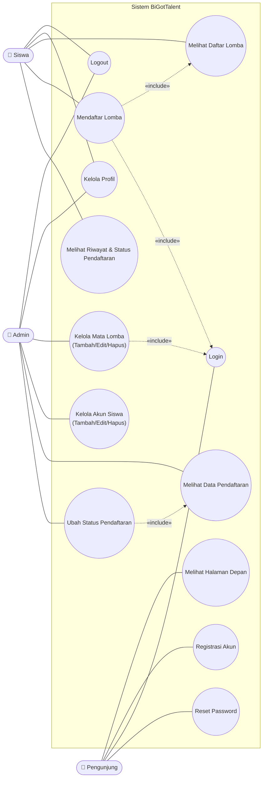

> Mermaid tidak punya notasi use case resmi. Untuk laporan, diagram ini bisa digambar ulang di draw.io / StarUML dengan elemen yang sama.

---

## 2. Activity Diagram

### 2.1 Login & Pengarahan Berdasarkan Role

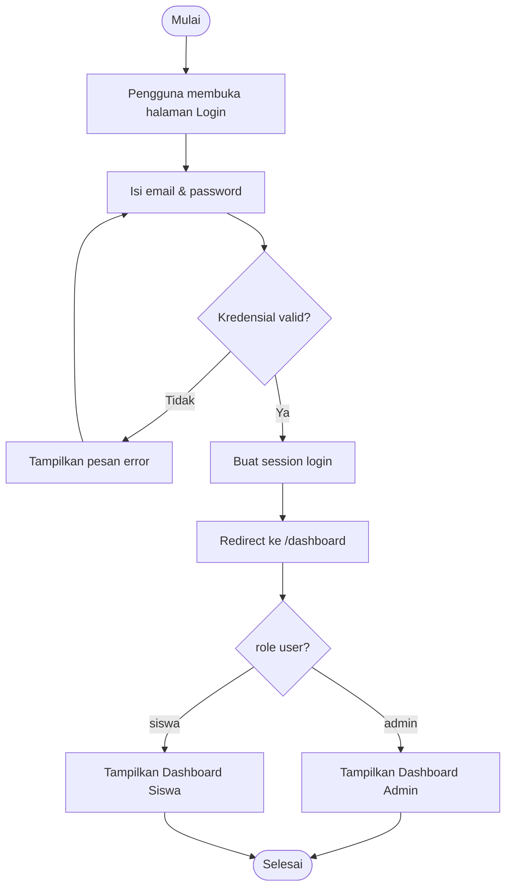

### 2.2 Siswa Mendaftar Lomba

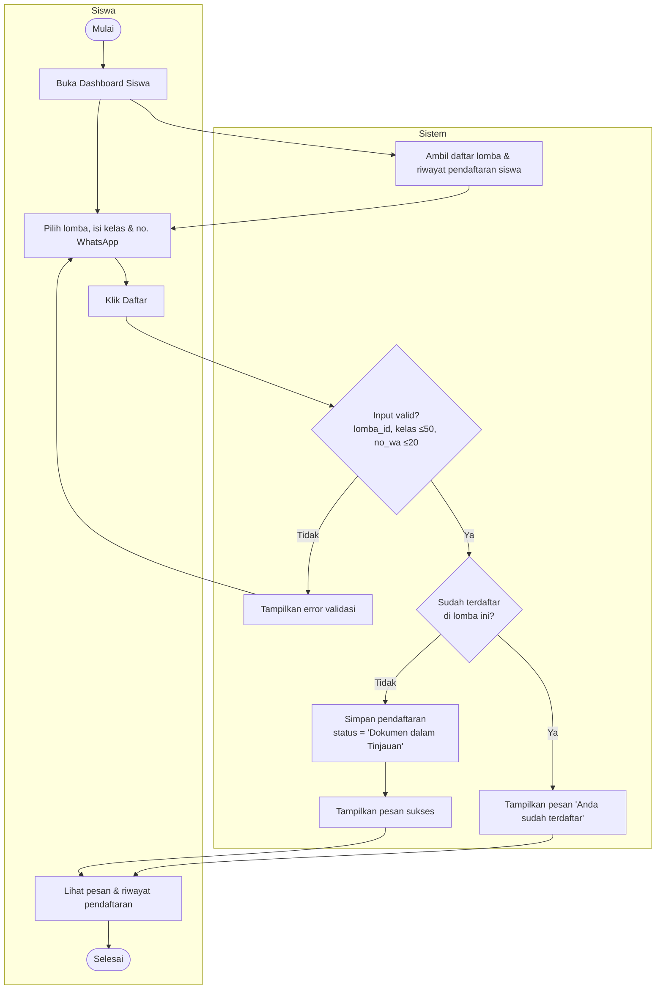

### 2.3 Admin Mengubah Status Pendaftaran

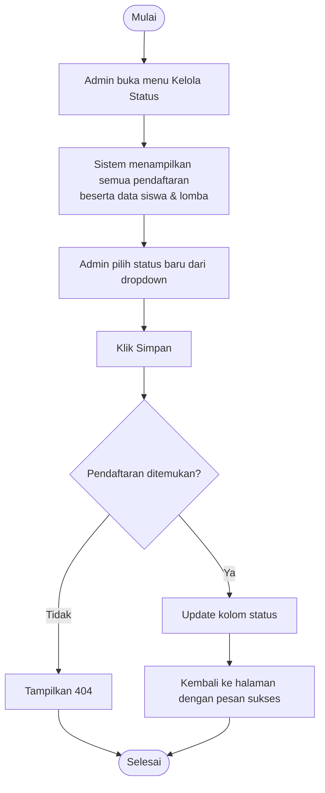

### 2.4 Admin Mengelola Mata Lomba (CRUD)

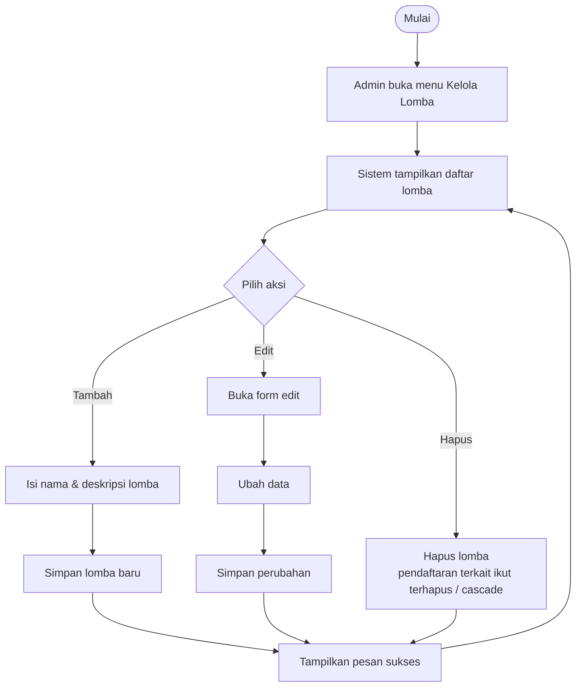

---

## 3. Class Diagram

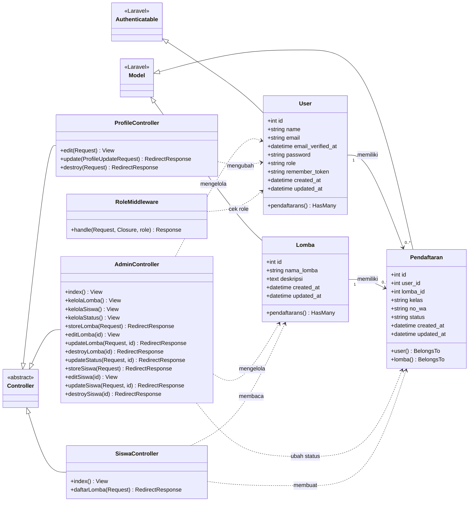

---

## 4. Sequence Diagram

### 4.1 Login

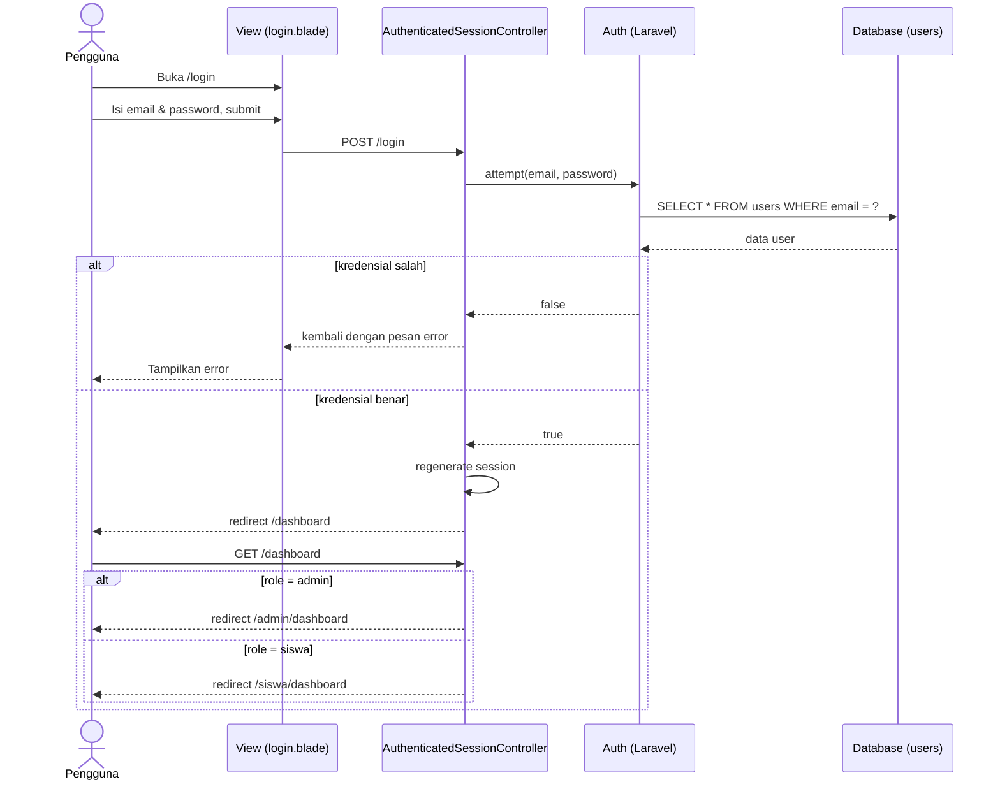

### 4.2 Siswa Mendaftar Lomba

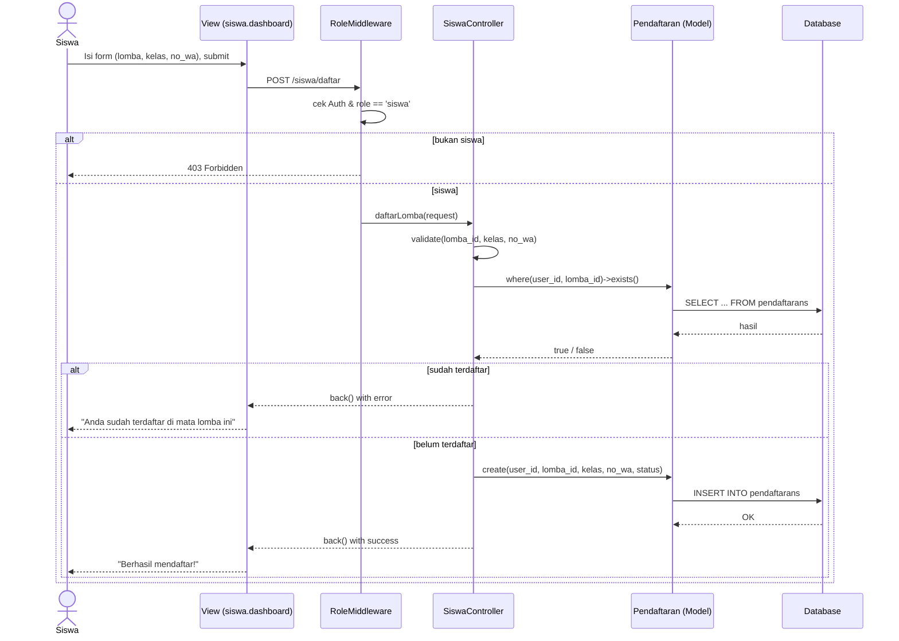

### 4.3 Admin Mengubah Status Pendaftaran

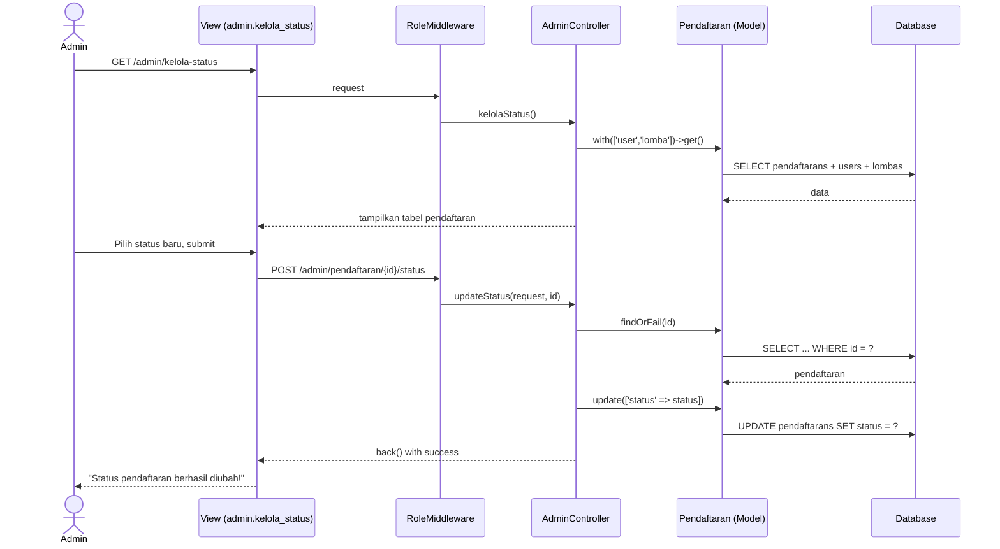

### 4.4 Admin Menambah Mata Lomba

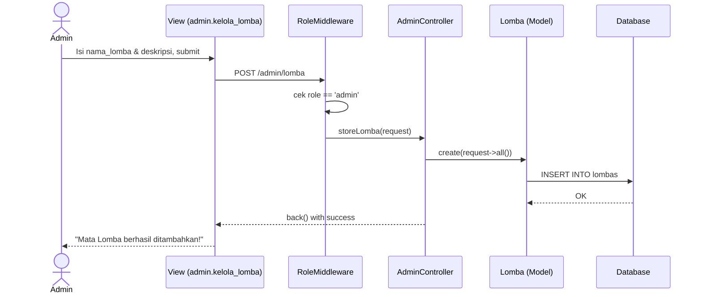

### 4.5 Admin Menambah Akun Siswa

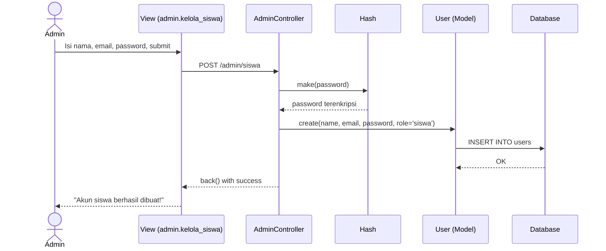

---

## 5. ERD (Entity Relationship Diagram)

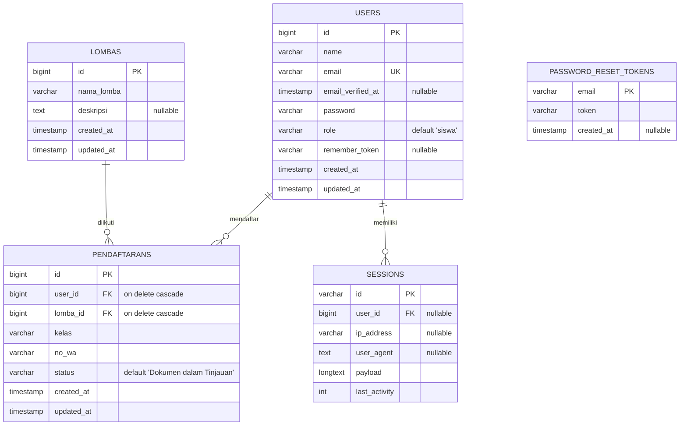

Kardinalitas:

- **USERS – PENDAFTARANS**: satu siswa dapat memiliki banyak pendaftaran (1 : N).
- **LOMBAS – PENDAFTARANS**: satu lomba dapat diikuti banyak pendaftaran (1 : N).
- Secara konsep, **USERS** dan **LOMBAS** berelasi *many-to-many* melalui tabel **PENDAFTARANS**, dan aplikasi mencegah satu siswa mendaftar lomba yang sama dua kali (dicek di `SiswaController::daftarLomba`).
- `password_reset_tokens` berhubungan dengan `users` lewat kolom `email` (tanpa foreign key).
